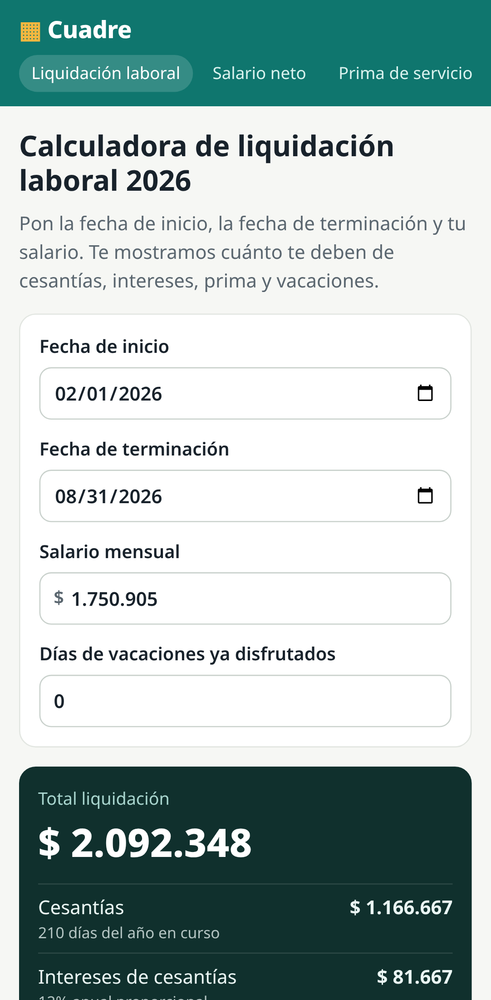
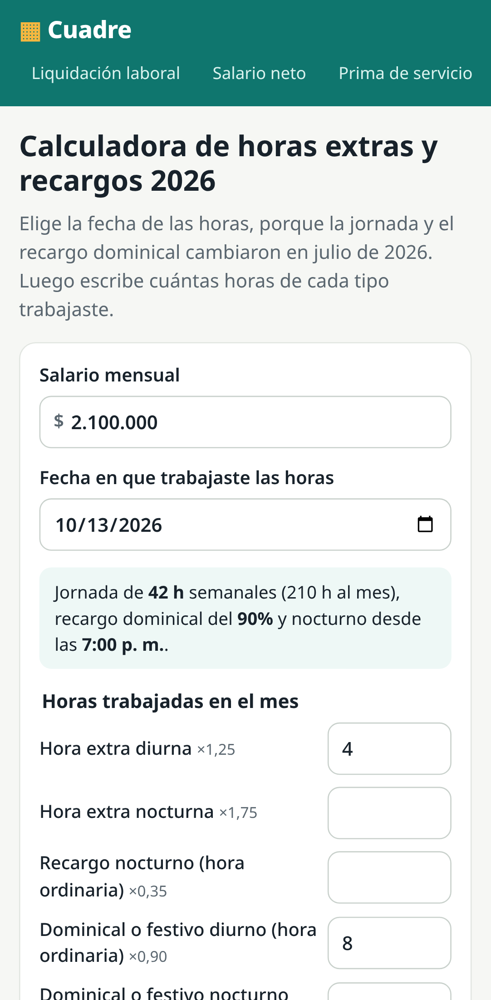

# Cuadre

**Calculadoras laborales y de seguridad social para Colombia, con valores 2026.**
Demo: **https://cuadrelaboral.com/**

| Calculadora                                                                                          | Qué calcula                                                                  |
| ---------------------------------------------------------------------------------------------------- | ---------------------------------------------------------------------------- |
| [Liquidación laboral](https://cuadrelaboral.com/liquidacion/)                                 | Cesantías, intereses, prima y vacaciones con fechas del contrato y salario   |
| [Salario neto](https://cuadrelaboral.com/salario-neto/)                                       | Salud 4%, pensión 4%, Fondo de Solidaridad Pensional y auxilio de transporte |
| [Prima de servicios](https://cuadrelaboral.com/prima/)                                        | Prima de junio o diciembre según días trabajados                             |
| [Intereses de cesantías](https://cuadrelaboral.com/intereses-cesantias/)                      | 12% anual proporcional                                                       |
| [Horas extras y recargos](https://cuadrelaboral.com/horas-extras/)                            | Jornada y recargo dominical según la fecha (42 h y 90% desde julio de 2026)  |
| [Seguridad social independientes](https://cuadrelaboral.com/seguridad-social-independientes/) | IBC 40%, salud 12,5%, pensión 16%, FSP y ARL                                 |

<p>
  
  
</p>

## Valores 2026 y fuentes

| Valor                     | 2026                                                                        | Fuente oficial                                                            |
| ------------------------- | --------------------------------------------------------------------------- | ------------------------------------------------------------------------- |
| Salario mínimo            | $1.750.905                                                                  | Decreto 1469 de 2025; fijado transitoriamente por el Decreto 0159 de 2026 |
| Auxilio de transporte     | $249.095                                                                    | Decreto 1470 de 2025                                                      |
| UVT                       | $52.374                                                                     | Resolución DIAN 000238 de 2025                                            |
| Jornada máxima            | 44 h hasta el 14-jul-2026, 42 h desde el 15-jul-2026                        | Ley 2101 de 2021                                                          |
| Recargo dominical/festivo | 80% hasta el 30-jun-2026, 90% desde el 1-jul-2026, 100% desde el 1-jul-2027 | Ley 2466 de 2025, art. 14                                                 |
| Trabajo nocturno          | 7:00 p. m. a 6:00 a. m. desde el 25-dic-2025, recargo 35%                   | Ley 2466 de 2025, art. 10; CST art. 168                                   |

Todos los valores viven en [`src/app/core/calc/values.ts`](src/app/core/calc/values.ts), con su enlace a la norma.
Cada página muestra la fuente y la fecha de actualización. Los resultados son aproximados y no son asesoría legal.

## Desarrollo

```bash
pnpm install
pnpm start          # http://localhost:4200
pnpm test           # Vitest: fórmulas con ejemplos resueltos y páginas
pnpm build:pages    # HTML prerenderizado por ruta + sitemap.xml + robots.txt
pnpm e2e            # Playwright (escritorio y celular) sobre el build de Pages
```

- Angular 22 con salida estática (`outputMode: "static"`): cada calculadora es un HTML propio con título, descripción, canonical, Open Graph y FAQ en JSON-LD.
- AdSense: define las variables del repositorio `ADSENSE_CLIENT` (`ca-pub-…`) y `ADSENSE_SLOT`. Sin ellas no se muestra ningún espacio.

Hecho por [JFredDev](https://jfredmc.github.io/portfolio/). Licencia MIT.
